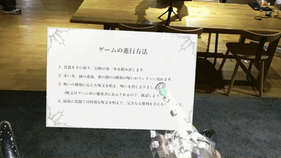
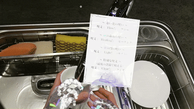

# Dishwashing - MR技術を用いた家事支援システム

HoloLens 2で、食器洗いをゲーム感覚で楽しめるMRコンテンツです。
プレイヤーは「呪われた食器」を魔法の呪文で浄化しながらスコアを獲得します。
2024年度の作品制作として、個人で約1か月かけて開発しました(自主制作)。

## デモ

### 遊び方とプレイの様子

### エフェクトの切り替えと結果画面

## 制作の背景

食器洗いは「面倒」「つまらない」と感じる人が多い家事です。
ゲーミフィケーション(ゲーム以外にゲーム性を取り入れる手法)を応用し、
食器洗いそのものを楽しい体験に変えることを目指しました。

## 主な機能

- **ハンドトラッキング**:手の動きにエフェクトが追従します
- **音声認識**:呪文を唱えると次のエフェクトが発生します
- **ランダム表示**:3種類のエフェクトをランダムに表示します
- **ゲーム要素**:時間計測、スコア、ランク評価
- **進行ガイド**:現在の手順を表示します

## 使用技術

- Unity 2022.3.10f1
- HoloLens 2
- Mixed Reality Toolkit (MRTK) 2.8.3
- OpenXR Plugin 1.11.1
- C#

## 工夫した点・苦労した点

### 1. 食器の認識をやめ、ハンドトラッキングに切り替えた
HoloLensの空間認識で食器を認識しようとしましたが、食器よりもシンクに認識が集中してしまい、
安定して情報を得られませんでした。そこで、食器ではなく手の位置にエフェクトを表示する方式に変更しました。

### 2. 追従させる位置の検証
どの指・部位が最も安定するかを検証し、(右利きの場合)左手の親指の付け根が
最も動きが少なく、HoloLensの視野角にも収まりやすいことを確認しました。

### 3. エフェクト切り替えのトリガーに音声認識を採用
洗い方は人や食器によって異なるため、動作の認識は困難でした。
また、食器洗い以外の手の動きや視線の移動は作業の妨げになるため、音声認識を採用しました。

### 4. ユーザーテストをもとにした改善
- 操作手順が分かりにくい → 現在の手順を表示する進行ガイドを追加
- 文字が見づらい → テキストを拡大し、視線位置に合わせてUIを自動配置
- 呪文の聞き取りで集中が妨げられる → 音声認識時の注意事項を記載

## 検証結果

被験者10人に、通常の食器洗いとの比較アンケート(5段階評価)を実施しました。

- 多くの参加者が「通常より楽しい」「体感時間が短い」と回答
- 課題:呪文の認識のしづらさ、食器洗いへの集中のしづらさ、
  レベルアップ要素など継続的に楽しめる仕組みの不足

## 使用アセット・クレジット

- [Magic Effects FREE](https://assetstore.unity.com/packages/vfx/particles/spells/magic-effects-free-247933)(Hovl Studio)
- Mixed Reality Toolkit 2.8.3
- 効果音:[効果音ラボ](https://soundeffect-lab.info/sound/button/)

## 注意事項

Asset Storeの素材と効果音は、規約上の理由でこのリポジトリに含めていません。
そのため、Unityでプロジェクトを開くと、Missingと表示される箇所があります。